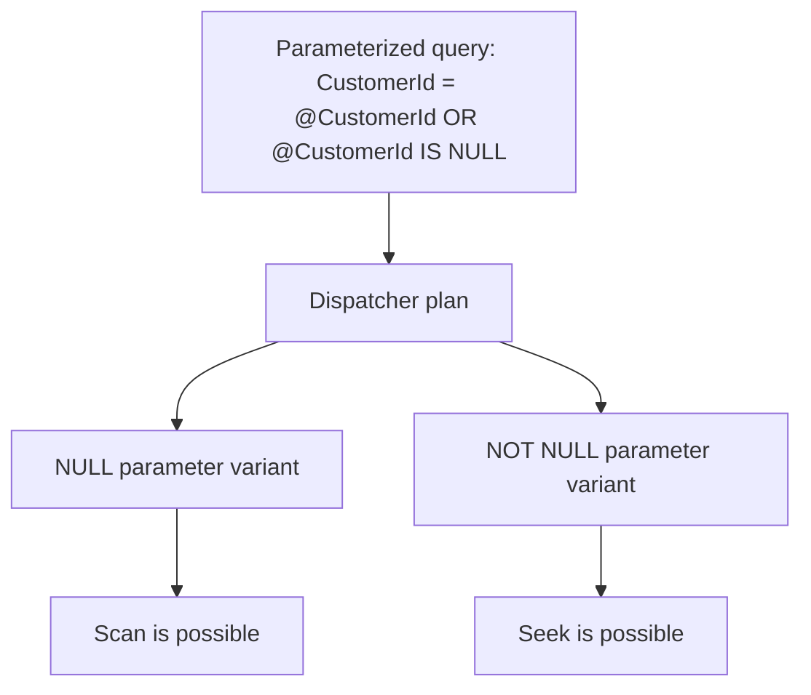

# SQL Server 2025 Optional Parameter Plan Optimization

The same optional search query does not always need the same plan.

This is a SQL-first demonstration of **Optional Parameter Plan Optimization (OPPO)** on SQL Server 2025. An e-commerce order search accepts `@CustomerId`. `NULL` means "return every order." A real customer id means "return that customer's orders." One parameterized statement has to be correct for both. SQL Server 2025 can keep more than one plan for an eligible statement and choose between them at execution time.

<!-- VALIDATION_SNAPSHOT_START -->
Generated by Invoke-Demo.ps1 from SQL Server output. Do not treat these figures as a guarantee on other hardware.

## Engine

- @@VERSION: Microsoft SQL Server 2025 (RTM-CU3) (KB5077896) - 17.0.4025.3 (X64)  	Feb 25 2026 20:54:27  	Copyright (C) 2025 Microsoft Corporation 	Express Edition (64-bit) on Windows 10 Pro 10.0 <X64> (Build 26300: ) (Hypervisor) 
- Product version: 17.0.4025.3
- Product level: RTM
- Product update level: CU3
- Edition: Express Edition (64-bit)
- EngineEdition: 4
- IsLocalDB: 1
- Compatibility level: 170
- OPTIONAL_PARAMETER_OPTIMIZATION value: 1 (is_value_default=1)
- PARAMETER_SENSITIVE_PLAN_OPTIMIZATION value: 1 (is_value_default=1)

## Data, indexes, and statistics

These catalog values were queried when the report was written. `12_ResetDemo.sql` clears the tables and the full runner then reloads them with the same generator and `dbo.DemoSettings`. Statistics timestamps are the last `UPDATE STATISTICS`, which is that reload when the reset phase ran. `dbo.CapturedPlan` and `dbo.PerformanceMeasurement` are not dropped by the reset, and scripts 08 and 09 are not rerun, so the plan and measurement tables still describe the measured executions.

customers=10000; orders=500000; selective_customer=125; selective_orders=20; selective_setting=20

- PK_Orders CLUSTERED column=OrderId key_ordinal=1 included=False
- IX_Orders_CustomerId NONCLUSTERED column=OrderDate key_ordinal=0 included=True
- IX_Orders_CustomerId NONCLUSTERED column=TotalAmount key_ordinal=0 included=True
- IX_Orders_CustomerId NONCLUSTERED column=CustomerId key_ordinal=1 included=False

- Customers.PK_Customers rows=10000 sampled=10000 modified=0 updated=11/26/2026 15:38:50
- Orders.PK_Orders rows=500000 sampled=500000 modified=0 updated=11/26/2026 15:38:50
- Orders._WA_Sys_00000002_48CFD27E rows=500000 sampled=500000 modified=0 updated=11/26/2026 15:38:50
- Orders.IX_Orders_CustomerId rows=500000 sampled=500000 modified=0 updated=11/26/2026 15:38:51
- Orders._WA_Sys_00000003_48CFD27E rows=500000 sampled=500000 modified=0 updated=11/26/2026 15:38:51
- Orders._WA_Sys_00000005_48CFD27E rows=500000 sampled=500000 modified=0 updated=11/26/2026 15:38:52

## Plan operators from captured actual-plan XML

| Capture | Scenario | Source | Variant | Dispatcher | optional_predicate | Operator | Estimated rows | Actual rows | Actual logical reads |
| --- | --- | --- | --- | --- | --- | --- | --- | --- | --- |
| 9 | A_Disabled_NULL | StatisticsXml | null | False | 0 | Index Scan | 500000 | 500000 | 1799 |
| 10 | B_Disabled_Selective | StatisticsXml | null | False | 0 | Index Scan | 500000 | 20 | 1799 |
| 11 | C_Enabled_NULL | StatisticsXml | 2 | True | 1 | Index Scan | 500000 | 500000 | 1799 |
| 12 | D_Enabled_Selective | StatisticsXml | 1 | True | 1 | Index Seek | 288 | 20 | 3 |

Estimated rows are the showplan `EstimateRows` values. They are not rewritten to equal actual rows. A null variant id means that showplan had no `QueryVariantID` attribute. The plan-shape value `actual-plan-unavailable` is written by script 09 when `sys.dm_exec_query_statistics_xml` returns no XML for the procedure handle. The operators above come from `SET STATISTICS XML` plans stored in `dbo.CapturedPlan` and `execution-plans/*.statistics-xml.sqlplan`.

D_Enabled_Selective.statistics-xml.sqlplan NonParallelPlanReason=NoParallelPlansInDesktopOrExpressEdition.

## Query Store variant rows

These rows are the catalog at report time. The full runner clears Query Store during reset and then recreates the procedures, so the ids below belong to that later compilation. A variant row is OPPO evidence here only because `optional_predicate` is 1. The measurement plans are the STATISTICS XML files, not these Query Store ids.

- parent=SearchOrders_After dispatcher_plan_id=56 variant_query_id=43 optional_predicate=1
- parent=SearchOrders_After dispatcher_plan_id=56 variant_query_id=45 optional_predicate=1

## STATISTICS IO and TIME

A CPU or elapsed value of 0 ms is the value STATISTICS TIME returned. SQL Server reports those counters in whole milliseconds. Logical and physical reads are the sum of `Table 'Orders'` counters inside each measure marker. CPU and elapsed time are the maximum `SQL Server Execution Times` values inside that marker. Parse and compile time is summed separately and is not added to execution time. A blank parse means the message was not present. `not in output` means the parser did not find that counter.

Orders STATISTICS IO lines in the measurement log, grouped by physical reads and read-ahead reads. The comparison table uses physical reads only.

- physical reads 0, read-ahead reads 0 (20 Orders lines)
- physical reads 3, read-ahead reads 0 (1 Orders lines)
- physical reads 3, read-ahead reads 1795 (3 Orders lines)

### Every run

| Scenario | OPPO | Parameter | Cache | Run | Logical reads | Physical reads | CPU ms | Elapsed ms | Compile CPU ms | Compile elapsed ms | Plan shape |
| --- | --- | --- | --- | --- | --- | --- | --- | --- | --- | --- | --- |
| A_Disabled_NULL | Disabled | NULL | Cold | 0 | 1799 | 3 | 359 | 423 | 0 | 4 | actual-plan-unavailable |
| A_Disabled_NULL | Disabled | NULL | Warm | 1 | 1799 | 0 | 375 | 386 | 0 | 0 | actual-plan-unavailable |
| A_Disabled_NULL | Disabled | NULL | Warm | 2 | 1799 | 0 | 359 | 436 | 0 | 0 | actual-plan-unavailable |
| A_Disabled_NULL | Disabled | NULL | Warm | 3 | 1799 | 0 | 422 | 437 | 0 | 0 | actual-plan-unavailable |
| A_Disabled_NULL | Disabled | NULL | Warm | 4 | 1799 | 0 | 328 | 377 | 0 | 0 | actual-plan-unavailable |
| A_Disabled_NULL | Disabled | NULL | Warm | 5 | 1799 | 0 | 281 | 363 | 0 | 0 | actual-plan-unavailable |
| B_Disabled_Selective | Disabled | 125 | Cold | 0 | 1799 | 3 | 78 | 78 | 4 | 4 | actual-plan-unavailable |
| B_Disabled_Selective | Disabled | 125 | Warm | 1 | 1799 | 0 | 31 | 54 | 0 | 0 | actual-plan-unavailable |
| B_Disabled_Selective | Disabled | 125 | Warm | 2 | 1799 | 0 | 62 | 65 | 0 | 0 | actual-plan-unavailable |
| B_Disabled_Selective | Disabled | 125 | Warm | 3 | 1799 | 0 | 79 | 77 | 0 | 0 | actual-plan-unavailable |
| B_Disabled_Selective | Disabled | 125 | Warm | 4 | 1799 | 0 | 62 | 66 | 0 | 0 | actual-plan-unavailable |
| B_Disabled_Selective | Disabled | 125 | Warm | 5 | 1799 | 0 | 62 | 64 | 0 | 0 | actual-plan-unavailable |
| C_Enabled_NULL | Enabled | NULL | Cold | 0 | 1799 | 3 | 359 | 409 | 0 | 5 | actual-plan-unavailable |
| C_Enabled_NULL | Enabled | NULL | Warm | 1 | 1799 | 0 | 360 | 393 | 0 | 0 | actual-plan-unavailable |
| C_Enabled_NULL | Enabled | NULL | Warm | 2 | 1799 | 0 | 390 | 408 | 0 | 0 | actual-plan-unavailable |
| C_Enabled_NULL | Enabled | NULL | Warm | 3 | 1799 | 0 | 297 | 415 | 0 | 0 | actual-plan-unavailable |
| C_Enabled_NULL | Enabled | NULL | Warm | 4 | 1799 | 0 | 359 | 393 | 0 | 0 | actual-plan-unavailable |
| C_Enabled_NULL | Enabled | NULL | Warm | 5 | 1799 | 0 | 375 | 413 | 0 | 0 | actual-plan-unavailable |
| D_Enabled_Selective | Enabled | 125 | Cold | 0 | 3 | 3 | 0 | 8 | 0 | 6 | actual-plan-unavailable |
| D_Enabled_Selective | Enabled | 125 | Warm | 1 | 3 | 0 | 0 | 0 | 0 | 0 | actual-plan-unavailable |
| D_Enabled_Selective | Enabled | 125 | Warm | 2 | 3 | 0 | 0 | 0 | 0 | 0 | actual-plan-unavailable |
| D_Enabled_Selective | Enabled | 125 | Warm | 3 | 3 | 0 | 0 | 0 | 0 | 0 | actual-plan-unavailable |
| D_Enabled_Selective | Enabled | 125 | Warm | 4 | 3 | 0 | 0 | 0 | 0 | 0 | actual-plan-unavailable |
| D_Enabled_Selective | Enabled | 125 | Warm | 5 | 3 | 0 | 0 | 0 | 0 | 0 | actual-plan-unavailable |

### Cold run and warm median

Warm median uses runs numbered 1 and above. The median of an even count is the mean of the two middle values.

| Scenario | OPPO | Parameter | Cold logical reads | Warm runs | Warm median logical reads | Warm median CPU ms | Warm median elapsed ms |
| --- | --- | --- | --- | --- | --- | --- | --- |
| A_Disabled_NULL | Disabled | NULL | 1799 | 5 | 1799 | 359 | 386 |
| B_Disabled_Selective | Disabled | 125 | 1799 | 5 | 1799 | 62 | 65 |
| C_Enabled_NULL | Enabled | NULL | 1799 | 5 | 1799 | 360 | 408 |
| D_Enabled_Selective | Enabled | 125 | 3 | 5 | 3 | 0 | 0 |

## Statement counters from sys.dm_exec_query_stats

These are the values stored in `dbo.PerformanceMeasurement` from `sys.dm_exec_query_stats` immediately after each measured execution. A null counter is a null returned for that procedure statement, not a zero. STATISTICS IO and the STATISTICS XML plans are the source for logical reads when this column is null. `last_physical_reads` on a cold scan can include read-ahead pages; the STATISTICS IO physical-reads column above does not.

| Scenario | OPPO | Parameter | Cache | Run | Logical reads | Physical reads | CPU microseconds | Elapsed microseconds | Plan shape |
| --- | --- | --- | --- | --- | --- | --- | --- | --- | --- |
| A_Disabled_NULL | Disabled | NULL | Cold | 0 | 1799 | 1798 | 405548 | 418816 | actual-plan-unavailable |
| A_Disabled_NULL | Disabled | NULL | Warm | 1 | 1799 | 0 | 377600 | 386649 | actual-plan-unavailable |
| A_Disabled_NULL | Disabled | NULL | Warm | 2 | 1799 | 0 | 416194 | 436089 | actual-plan-unavailable |
| A_Disabled_NULL | Disabled | NULL | Warm | 3 | 1799 | 0 | 425495 | 437179 | actual-plan-unavailable |
| A_Disabled_NULL | Disabled | NULL | Warm | 4 | 1799 | 0 | 355065 | 377328 | actual-plan-unavailable |
| A_Disabled_NULL | Disabled | NULL | Warm | 5 | 1799 | 0 | 346990 | 363820 | actual-plan-unavailable |
| B_Disabled_Selective | Disabled | 125 | Cold | 0 | 1799 | 1798 | 73624 | 74457 | actual-plan-unavailable |
| B_Disabled_Selective | Disabled | 125 | Warm | 1 | 1799 | 0 | 54493 | 54496 | actual-plan-unavailable |
| B_Disabled_Selective | Disabled | 125 | Warm | 2 | 1799 | 0 | 65560 | 65564 | actual-plan-unavailable |
| B_Disabled_Selective | Disabled | 125 | Warm | 3 | 1799 | 0 | 77663 | 77667 | actual-plan-unavailable |
| B_Disabled_Selective | Disabled | 125 | Warm | 4 | 1799 | 0 | 66800 | 66803 | actual-plan-unavailable |
| B_Disabled_Selective | Disabled | 125 | Warm | 5 | 1799 | 0 | 64465 | 64468 | actual-plan-unavailable |
| C_Enabled_NULL | Enabled | NULL | Cold | 0 | null | null | null | null | actual-plan-unavailable |
| C_Enabled_NULL | Enabled | NULL | Warm | 1 | null | null | null | null | actual-plan-unavailable |
| C_Enabled_NULL | Enabled | NULL | Warm | 2 | null | null | null | null | actual-plan-unavailable |
| C_Enabled_NULL | Enabled | NULL | Warm | 3 | null | null | null | null | actual-plan-unavailable |
| C_Enabled_NULL | Enabled | NULL | Warm | 4 | null | null | null | null | actual-plan-unavailable |
| C_Enabled_NULL | Enabled | NULL | Warm | 5 | null | null | null | null | actual-plan-unavailable |
| D_Enabled_Selective | Enabled | 125 | Cold | 0 | null | null | null | null | actual-plan-unavailable |
| D_Enabled_Selective | Enabled | 125 | Warm | 1 | null | null | null | null | actual-plan-unavailable |
| D_Enabled_Selective | Enabled | 125 | Warm | 2 | null | null | null | null | actual-plan-unavailable |
| D_Enabled_Selective | Enabled | 125 | Warm | 3 | null | null | null | null | actual-plan-unavailable |
| D_Enabled_Selective | Enabled | 125 | Warm | 4 | null | null | null | null | actual-plan-unavailable |
| D_Enabled_Selective | Enabled | 125 | Warm | 5 | null | null | null | null | actual-plan-unavailable |

## Tests

- Initial correctness: passed=16 failed=0 skipped=0 not_run=0
- Reset state: passed=7 failed=0 skipped=0 not_run=0
- Correctness after reset and reload: passed=16 failed=0 skipped=0 not_run=0

## Machine

- Processor: Intel(R) Core(TM) i7-8550U CPU @ 1.80GHz
- Physical memory GB: 23.87
- dotnet --list-sdks: 8.0.428 [C:\Program Files\dotnet\sdk]
9.0.321 [C:\Program Files\dotnet\sdk]
10.0.401 [C:\Program Files\dotnet\sdk]
- docker info: Docker CLI is installed on this machine; the engine query did not succeed. failed to connect to the docker API at npipe:////./pipe/dockerDesktopLinuxEngine; check if the path is correct and if the daemon is running: open //./pipe/dockerDesktopLinuxEngine: The system cannot find the file specified.

## Phases

| Phase | Status | Detail |
| --- | --- | --- |
| Connection target | recorded | server=(localdb)\SqlServerOPPODemo; database=SqlServerOPPODemo |
| Start LocalDB SqlServerOPPODemo | completed | instance start command returned 0 |
| 00_Prerequisites.sql | completed | sqlcmd exit 0 |
| 01_CreateDatabase.sql | completed | sqlcmd exit 0 |
| 02_CreateTables.sql | completed | sqlcmd exit 0 |
| 03_GenerateData.sql | completed | sqlcmd exit 0 |
| 04_CreateIndexes.sql | completed | sqlcmd exit 0 |
| 05_VerifyConfiguration.sql | completed | sqlcmd exit 0 |
| 06_Before_OPPO_Disabled.sql | completed | sqlcmd exit 0 |
| 07_After_OPPO_Enabled.sql | completed | sqlcmd exit 0 |
| 08_CompareExecutionPlans.sql | completed | sqlcmd exit 0 |
| Export sqlplan files | completed | files=4 |
| STATISTICS XML actual plans | completed | files=4 |
| 09_StatisticsIO_Time.sql | completed | STATISTICS IO/TIME messages written to results/raw/09_StatisticsIO_Time.log |
| 10_QueryStoreAnalysis.sql | completed | sqlcmd exit 0 |
| 11_CheckOPPOEligibility.sql | completed | sqlcmd exit 0 |
| Correctness tests | completed | sqlcmd exit 0 |
| 12_ResetDemo.sql | completed | sqlcmd exit 0 |
| Reset assertions | completed | sqlcmd exit 0 |
| rerun 03_GenerateData.sql | completed | sqlcmd exit 0 |
| rerun 04_CreateIndexes.sql | completed | sqlcmd exit 0 |
| rerun 06_Before_OPPO_Disabled.sql | completed | sqlcmd exit 0 |
| rerun 07_After_OPPO_Enabled.sql | completed | sqlcmd exit 0 |
| Correctness tests after reset | completed | sqlcmd exit 0 |
| Report only | completed | Reloaded the measurement log and queried SQL Server again. |

Fatal error: none
<!-- VALIDATION_SNAPSHOT_END -->

## 1. Project overview

The demo database is `SqlServerOPPODemo`. Two stored procedures share the same `SELECT` and `WHERE` text:

- `dbo.SearchOrders_Before` adds `OPTION (USE HINT('DISABLE_OPTIONAL_PARAMETER_OPTIMIZATION'))`.
- `dbo.SearchOrders_After` leaves OPPO enabled.

Scripts create the database, load a deterministic data set, build one supporting index, compare plans, and run correctness tests. There is no application tier. `Invoke-Demo.ps1` is a client for running those scripts and saving the XML SQL Server returns.

## 2. What optional parameters mean

An optional parameter is a procedure or `sp_executesql` parameter whose `NULL` state means "do not apply this filter."

```sql
WHERE CustomerId = @CustomerId
   OR @CustomerId IS NULL
```

`@CustomerId = 125` returns orders for customer 125. `@CustomerId = NULL` returns orders for every customer. The application keeps one search statement instead of building different SQL strings.

## 3. Real search API scenario

The fictional store has `dbo.Customers` and `dbo.Orders`. The order search API always calls the same procedure.

| Call | Meaning |
| --- | --- |
| `EXEC dbo.SearchOrders_After @CustomerId = NULL` | Every order |
| `EXEC dbo.SearchOrders_After @CustomerId = 125` | Orders for customer 125 only |

Customer 125 is the default selective customer. `dbo.DemoSettings` holds the row counts and that customer id so the scripts do not need a list of hardcoded sizes.

## 4. Why optional predicates can be slow

Without OPPO, the optimizer caches one plan that must stay correct for both parameter states. A seek that assumes `@CustomerId` equals a customer id is not valid when the parameter is `NULL`, because the predicate is true for every row. The conservative plan is often a scan. Selective calls then read more pages than a seek would.

That outcome depends on statistics, indexes, cardinality, and whether the statement is eligible. An optional predicate does not guarantee a scan.

## 5. What OPPO is

OPPO is an intelligent query processing feature for this `NULL` / not-`NULL` plan problem. It uses the same multiplan infrastructure as parameter-sensitive plan optimization, but it dispatches on parameter nullability rather than on cardinality ranges.

For an eligible statement the engine can create:

- a dispatcher plan
- a variant for the `NULL` state
- a variant for the not-`NULL` state

At execution, the dispatcher evaluates the parameter and runs the matching variant. The variant can fold `@CustomerId IS NULL` to a constant, which lets the optimizer consider a plan that would have been invalid as the single reusable plan.

## 6. What's new in SQL Server 2025

OPPO is part of intelligent query processing in SQL Server 2025 (17.x), Azure SQL Database, and SQL database in Microsoft Fabric. The engine major version is 17. Earlier engines do not contain this feature, even if a script asks for compatibility level 170.

## 7. Compatibility level 170

Database compatibility level and engine version are different controls.

| Control | What it is | OPPO requirement |
| --- | --- | --- |
| Engine version | The installed SQL Server build, reported by `@@VERSION` and `SERVERPROPERTY('ProductVersion')` | SQL Server 2025 (17.x), or Azure SQL / Fabric where the feature exists |
| Compatibility level | A per-database setting, `sys.databases.compatibility_level` | 170 for the database being tuned |

A database restored onto SQL Server 2025 can remain at an older compatibility level. OPPO does not turn on for that database until its compatibility level is 170 and the scoped configuration allows it. Changing a production database to 170 is a separate test from upgrading the instance. This project changes compatibility only on `SqlServerOPPODemo`.

## 8. Feature configuration

Inside `SqlServerOPPODemo`:

```sql
ALTER DATABASE SqlServerOPPODemo SET COMPATIBILITY_LEVEL = 170;
ALTER DATABASE SCOPED CONFIGURATION SET OPTIONAL_PARAMETER_OPTIMIZATION = ON;
```

`OPTIONAL_PARAMETER_OPTIMIZATION` defaults to `ON` at compatibility level 170. Confirm it from the catalog instead of assuming the default survived:

```sql
SELECT compatibility_level
FROM sys.databases
WHERE name = N'SqlServerOPPODemo';

SELECT name, CONVERT(int, value) AS configuration_value, is_value_default
FROM sys.database_scoped_configurations
WHERE name = N'OPTIONAL_PARAMETER_OPTIMIZATION';
```

The BEFORE procedure does not turn this setting off. It uses the query hint so the AFTER procedure in the same database can still use OPPO:

```sql
OPTION (USE HINT('DISABLE_OPTIONAL_PARAMETER_OPTIMIZATION'));
```

Turning the scoped configuration `OFF` is the database-wide alternative. `sql/06_Before_OPPO_Disabled.sql` documents that statement and does not execute it.

## 9. Dataset setup

`dbo.DemoSettings` controls the load:

| Setting | Default | Allowed range |
| --- | --- | --- |
| `CustomerCount` | 10000 | 125 to 50000 |
| `OrderCount` | 500000 | 50000 to 1000000, and at least five times `CustomerCount` |
| `SelectiveCustomerId` | 125 | 1 through `CustomerCount` |
| `SelectiveOrderCount` | 20 | 1 to 1000, and at most 2 percent of orders |
| `MeasuredRuns` | 5 | 1 to 10 warm repetitions |

`sql/03_GenerateData.sql` builds a number set with cross joins, then inserts in batches of 100,000. Customer ids and order values are functions of the order number, so a rerun with the same settings produces the same rows. The selective customer receives exactly `SelectiveOrderCount` orders. About half of the other orders go to customers 1–50, about 40 percent to customers 51–500, and the rest to higher ids. A bucket that would land on the selective customer is moved aside so that customer's count stays exact.

To resize the set, update the one settings row and rerun scripts 03 and 04:

```sql
UPDATE dbo.DemoSettings
SET CustomerCount = 10000,
    OrderCount = 500000,
    SelectiveCustomerId = 125,
    SelectiveOrderCount = 20,
    MeasuredRuns = 5
WHERE SettingsId = 1;
```

An `OrderCount` below 100,000 prints a warning. Eligibility thresholds are the engine's, and a small table may not receive variants.

## 10. Indexing strategy

`dbo.Orders.OrderId` is the clustered primary key. `dbo.Customers.CustomerId` is the clustered primary key. `FK_Orders_Customers` references customers.

`sql/04_CreateIndexes.sql` creates one nonclustered index after the load:

```sql
CREATE NONCLUSTERED INDEX IX_Orders_CustomerId
    ON dbo.Orders (CustomerId)
    INCLUDE (OrderDate, TotalAmount);
```

The search returns `OrderId`, `CustomerId`, `OrderDate`, and `TotalAmount`. `OrderId` is already in the nonclustered leaf because it is the clustering key. `OrderStatus` is not returned by the search and is not included. Statistics are updated with `FULLSCAN` after the load and again after the index build. OPPO does not replace this index. A not-`NULL` variant can only seek if an index supports the predicate.

## 11. BEFORE — ONE REUSABLE PLAN

```sql
CREATE OR ALTER PROCEDURE dbo.SearchOrders_Before
    @CustomerId int
AS
BEGIN
    SET NOCOUNT ON;

    SELECT
        OrderId,
        CustomerId,
        OrderDate,
        TotalAmount
    FROM dbo.Orders
    WHERE CustomerId = @CustomerId
       OR @CustomerId IS NULL
    OPTION (USE HINT('DISABLE_OPTIONAL_PARAMETER_OPTIMIZATION'));
END;
```

Calls use the parameter. They do not concatenate the customer id into the SQL text:

```sql
EXEC dbo.SearchOrders_Before @CustomerId = NULL;
EXEC dbo.SearchOrders_Before @CustomerId = 125;
```

The scripted files read `SelectiveCustomerId` from `dbo.DemoSettings` (default 125) and pass that value as the procedure argument. `INSERT...EXEC` consumes the `NULL` result so a script run does not print every order. That outer insert is not part of the procedure.

## 12. AFTER — OPTIONAL PARAMETER PLAN OPTIMIZATION

```sql
CREATE OR ALTER PROCEDURE dbo.SearchOrders_After
    @CustomerId int
AS
BEGIN
    SET NOCOUNT ON;

    SELECT
        OrderId,
        CustomerId,
        OrderDate,
        TotalAmount
    FROM dbo.Orders
    WHERE CustomerId = @CustomerId
       OR @CustomerId IS NULL;
END;
```

The business predicate is unchanged. The difference is the absence of the disabling hint, with compatibility level 170 and `OPTIONAL_PARAMETER_OPTIMIZATION = ON`.

The same text can be sent through `sp_executesql`. The executed demo uses the procedure so Query Store can tie the statement to an object id:

```sql
EXEC sys.sp_executesql
    N'SELECT OrderId, CustomerId, OrderDate, TotalAmount
      FROM dbo.Orders
      WHERE CustomerId = @CustomerId
         OR @CustomerId IS NULL;',
    N'@CustomerId int',
    @CustomerId = 125;
```

## 13. How dispatcher plans work



The dispatcher evaluates whether the parameter is `NULL`. It does not itself have to be the scan or the seek. Query Store runtime statistics for the dispatcher plan are empty by design; variant plans hold the execution statistics. Aggregate parent-query resource use by joining `sys.query_store_query_variant` to the variant plans.

## 14. How query variants work

Each variant is compiled for one parameter state. SQL Server embeds a system-generated `PLAN PER VALUE` hint with `optional_predicate` in the plan's statement text. That hint is engine metadata. Do not add `PLAN PER VALUE` to application code. It is not a supported hint to write by hand.

`sys.query_store_query_variant` stores the parent query id, the variant query id, and the dispatcher plan id. The same view also serves parameter-sensitive plan optimization. A row in the view identifies a multiplan variant. OPPO-specific evidence in this demo is the `optional_predicate` / `OptionalParameterPredicate` marker in the statement or showplan returned by SQL Server.

### OPPO is not PSP

| | OPPO | PSP |
| --- | --- | --- |
| Chooses a plan by | `NULL` versus not `NULL` | Estimated cardinality ranges for a parameter value |
| Scoped configuration | `OPTIONAL_PARAMETER_OPTIMIZATION` | `PARAMETER_SENSITIVE_PLAN_OPTIMIZATION` |
| Compatibility level | 170 | 160 |
| Introduced | SQL Server 2025 | SQL Server 2022 |

One statement can be eligible for either, both, or neither. OPPO does not fix every parameter-sniffing problem. A highly skewed non-null value, such as one customer owning most of the table, is a PSP question. This data set has that skew on purpose so the table looks like production, and the scripts identify OPPO with `optional_predicate` rather than with the shared variant view alone.

## 15. Actual execution plan comparison

`sql/08_CompareExecutionPlans.sql` runs four executions and stores the XML SQL Server returns:

| Scenario | Procedure | Parameter |
| --- | --- | --- |
| A | `SearchOrders_Before` | `NULL` |
| B | `SearchOrders_Before` | selective customer |
| C | `SearchOrders_After` | `NULL` |
| D | `SearchOrders_After` | selective customer |

`LAST_QUERY_PLAN_STATS` is enabled on the demo database. The script reads `sys.dm_exec_query_statistics_xml` for the actual plan and `sys.dm_exec_query_plan` for cached plans. `Invoke-Demo.ps1` writes each stored XML document to `execution-plans/*.sqlplan` without editing it. Opening those files in SSMS is described in [execution-plans/README.md](execution-plans/README.md).

Operator names, estimated rows, and actual rows in the validation snapshot come from shredding that XML. If the shred returns no access operator, the snapshot says so.

## 16. STATISTICS IO/TIME instructions

`sql/09_StatisticsIO_Time.sql` turns on:

```sql
SET STATISTICS IO ON;
SET STATISTICS TIME ON;
```

Each scenario has one cold run (run 0) and `MeasuredRuns` warm runs (default 5). Run 0 clears the demo database procedure cache with `ALTER DATABASE SCOPED CONFIGURATION CLEAR PROCEDURE_CACHE`. On LocalDB, and only when `SqlServerOPPODemo` is the only user database, run 0 also executes `CHECKPOINT` and `DBCC DROPCLEANBUFFERS`. That buffer-pool command is instance-wide, so the script skips it on any other instance shape and labels the run `CacheClearedBufferPoolNotCleared`.

The runner executes script 09 through `SqlClient` and lets the client library discard result rows. SSMS users should enable **Discard results after execution** before running script 09, or the grid will hold every order from the `NULL` calls.

The parser in `Invoke-Demo.ps1` builds the comparison from the message text:

| Scenario | OPPO status | Parameter | Plan shape | Logical reads | CPU time | Elapsed time |
| --- | --- | --- | --- | --- | --- | --- |
| Filled by the validation snapshot from STATISTICS IO/TIME | | | | | | |

Logical reads in that table are the sum of `Table 'Orders'` logical reads inside each marked execution. CPU and elapsed time are the maximum `SQL Server Execution Times` values in that same marker. Parse and compile time is reported separately and is not added to execution time. `sys.dm_exec_query_stats` statement counters are stored in `dbo.PerformanceMeasurement` and shown beside the message parse, because a dispatcher and its variant can account for reads differently. Neither table is a promise that another machine will match the numbers. Elapsed time moves with CPU, IO, and cache state.

## 17. Query Store investigation

Script 01 enables Query Store on `SqlServerOPPODemo` in `READ_WRITE` mode with `QUERY_CAPTURE_MODE = ALL`. `sql/10_QueryStoreAnalysis.sql` flushes Query Store and reads only these confirmed views:

- `sys.query_store_query`
- `sys.query_store_query_text`
- `sys.query_store_plan` (`plan_type`, `plan_type_desc`, `count_compiles`, `last_compile_duration`, `query_plan`)
- `sys.query_store_query_variant` (`query_variant_query_id`, `parent_query_id`, `dispatcher_plan_id`)
- `sys.query_store_runtime_stats`

Compile duration and runtime duration/CPU columns from these views are microseconds. The script labels them. Dispatcher plans do not contribute runtime stats. Join variant plans when you want logical reads and CPU for the parent statement.

## 18. OPPO eligibility diagnostics

`sql/11_CheckOPPOEligibility.sql` checks that these extended events exist, then creates a session, runs examples, prints the ring-buffer fields, and drops the session:

- `optional_parameter_optimization_skipped_reason` (field `reason`; map `opo_skipped_reason_enum`)
- `query_with_optional_parameter_predicate` (fields `optional_parameter_optimization_supported`, `optional_parameter_predicate_count`, `predicate_details`, `query_type`)

The script prints `opo_skipped_reason_enum` from `sys.dm_xe_map_values` on the connected build. Use that result for the build you are on. Documented reasons a statement is ineligible include local variables instead of parameters, `OPTION (RECOMPILE)`, `SET ANSI_NULLS OFF`, and auto-parameterized SQL. The demo session runs a local-variable statement, an `OPTION (RECOMPILE)` statement, the enabled procedure, and the hint-disabled procedure so the captured `reason` values come from the engine.

Microsoft's eligibility list also includes compatibility below 170, the scoped configuration being off, and the disable hint. On the build used to develop this project, the map contained `CompatLevelBelow170`, `DBScopedConfigOff`, `QueryHint`, `HasLocalVar`, `WithRecompileFlag`, `AutoParameterized`, and `SkewnessThresholdNotMet`, among other labels. Re-run script 11 rather than treating that list as stable for every later cumulative update.

### Troubleshooting

1. Confirm `SERVERPROPERTY('ProductMajorVersion')` is 17.
2. Confirm `compatibility_level` is 170 for `SqlServerOPPODemo` only.
3. Confirm `OPTIONAL_PARAMETER_OPTIMIZATION` is 1.
4. Confirm the statement uses a parameter, not a local variable, and does not include `OPTION (RECOMPILE)` or the disable hint.
5. Confirm `ANSI_NULLS` is `ON`. Procedures in this project are created with it `ON`.
6. Confirm the predicate is the supported `column = @p OR @p IS NULL` shape and the SQL text is parameterized.
7. Update statistics and keep `IX_Orders_CustomerId`.
8. Read `optional_parameter_optimization_skipped_reason` and the map query in script 11.
9. Do not expect a seek for every not-`NULL` value. Read the actual plan.

## 19. Automated tests

SQL tests are the validation suite. A .NET test project is not included: the installed SDKs on the authoring machine were .NET 8, 9, and 10, not .NET 11, and the behavior under test is in the engine.

| Script | What it checks |
| --- | --- |
| `tests/01_CorrectnessTests.sql` | Engine major version 17, compatibility 170, OPPO on, hint placement, row counts, customer 125, index shape, `NULL` returns every order, the selective call returns only that customer, BEFORE and AFTER result sets match, the statement text matches apart from the hint, OPPO metadata exists for the enabled procedure, and the disabled procedure has no `optional_predicate` variant |
| `tests/02_AssertResetState.sql` | After script 12: database remains, compatibility and OPPO stay set, rows are gone, the search index and both procedures are gone |

Tests do not assert a runtime or a percentage speedup. `Invoke-Demo.ps1` runs the correctness suite, resets, reloads, and runs the suite again. Exact pass, fail, skipped, and not-run totals are printed as `TEST_TOTALS` and copied into the validation snapshot.

## 20. Reproduction instructions

Prerequisites:

- SQL Server 2025 (17.x). The authoring instance is LocalDB, which reports Express Edition. Developer Edition is not required for the scripts, and it was not installed here.
- `sqlcmd` on `PATH`.
- Windows PowerShell 5.1 or later.
- Permission to create `SqlServerOPPODemo`, alter its scoped configuration, view server state, and create an extended event session.
- Optional: SSMS, to open `.sqlplan` files.
- Optional: Docker. The daemon was not running during authoring, so no container was used.

Copy `.env.example` to `.env` only if you need a non-default instance. Leave the password fields empty to use Windows authentication. `.env` is gitignored.

Start the dedicated LocalDB instance if you are using the default:

```text
"C:\Program Files\Microsoft SQL Server\170\Tools\Binn\SqlLocalDB.exe" create SqlServerOPPODemo 17.0
"C:\Program Files\Microsoft SQL Server\170\Tools\Binn\SqlLocalDB.exe" start SqlServerOPPODemo
```

`create` is only for the first time. Connect as `(localdb)\SqlServerOPPODemo`. The pipe name in `@@SERVERNAME` changes when LocalDB restarts.

Run the full demonstration:

```powershell
powershell -ExecutionPolicy Bypass -File .\Invoke-Demo.ps1
```

Script order, if you prefer `sqlcmd` or SSMS SQLCMD mode from the `sql` directory:

| Order | Script |
| --- | --- |
| 0 | `sql/00_Prerequisites.sql` |
| 1 | `sql/01_CreateDatabase.sql` |
| 2 | `sql/02_CreateTables.sql` |
| 3 | `sql/03_GenerateData.sql` |
| 4 | `sql/04_CreateIndexes.sql` |
| 5 | `sql/05_VerifyConfiguration.sql` |
| 6 | `sql/06_Before_OPPO_Disabled.sql` |
| 7 | `sql/07_After_OPPO_Enabled.sql` |
| 8 | `sql/08_CompareExecutionPlans.sql` |
| 9 | `sql/09_StatisticsIO_Time.sql` |
| 10 | `sql/10_QueryStoreAnalysis.sql` |
| 11 | `sql/11_CheckOPPOEligibility.sql` |
| 12 | `sql/12_ResetDemo.sql` |

`sql/RunAll.sql` includes every script except 09 and 12. Script 09 returns the full search result on each repetition; use the PowerShell runner or SSMS with results discarded. Script 12 clears the demo.

Every execution script sets `ANSI_NULLS`, `QUOTED_IDENTIFIER`, `ANSI_PADDING`, `ANSI_WARNINGS`, `CONCAT_NULL_YIELDS_NULL`, `NUMERIC_ROUNDABORT`, and `ARITHABORT` so sqlcmd and SSMS do not compile different plans solely because of client defaults. sqlcmd is invoked with `-I` (`QUOTED_IDENTIFIER ON`).

### Reproducibility checklist

- Engine major version is 17, confirmed from `SERVERPROPERTY` rather than from the folder name.
- The only database whose compatibility level is changed is `SqlServerOPPODemo`, and it is 170.
- `OPTIONAL_PARAMETER_OPTIMIZATION` was read from `sys.database_scoped_configurations`.
- `dbo.DemoSettings` was not edited between the load and the measurement, or both were rerun after the edit.
- `IX_Orders_CustomerId` exists and statistics `last_updated` is populated.
- BEFORE and AFTER calls pass a parameter.
- Cold and warm runs are labeled, and `DBCC DROPCLEANBUFFERS` ran only on the guarded LocalDB path.
- Plan XML was saved from SQL Server, not drawn by hand.
- Test totals were copied from `TEST_TOTALS`, including skipped and not-run counts.

## 21. Known limitations

- Eligibility is decided by the engine. `SkewnessThresholdNotMet` and the other map values are real skip reasons. The project does not claim every optional filter gets a seek, a scan, or a variant.
- `PLAN PER VALUE` text is evidence when SQL Server emits it. The scripts never inject that hint.
- `sys.query_store_query_variant` is shared with PSP. OPPO is identified here by `optional_predicate`.
- Dispatcher plans do not record Query Store runtime stats.
- Measurement elapsed time includes sending rows to a local client that discards them. Logical reads of `dbo.Orders` do not depend on drawing a grid.
- LocalDB auto-shutdown and the Express resource limits are properties of that edition. A Developer or Enterprise instance can choose a different degree of parallelism. The captured plan is the authority for the run that produced it.
- The generator caps the table at 1,000,000 orders so the number table stays set-based.
- Script 12 does not drop the database. The commented teardown at the bottom of that file drops only `SqlServerOPPODemo`, and only if you run it yourself.

## 22. Production recommendations

- Upgrade the engine and change compatibility level as two tested steps. Do not alter production compatibility from this demo.
- Keep the scoped configuration change on a database you can observe. Compare Query Store compile CPU and logical reads before and after, with the same indexes and statistics.
- Extra variants use plan-cache memory. That cost is the trade for not recompiling every execution.
- `OPTION (RECOMPILE)` can also specialize a plan, and it blocks OPPO. It compiles on every execution. Use it when the statement is not eligible or when you accept that compile cost. It is not the same mechanism as a cached dispatcher.
- Dynamic SQL or an `IF @CustomerId IS NULL` branch remains appropriate when the patterns differ by more than nullability, when the statement is ineligible, or when you want the text itself to show which search ran. OPPO does not require that rewrite for an eligible statement.
- OPPO does not design indexes and it is not always faster. A `NULL` search of every order still reads every qualifying row. The win, when the feature engages and the index supports it, is the selective call no longer being tied to the conservative plan.
- Watch skipped-reason events while rolling out. A silent fallback to one plan is still a correct plan.

## 23. Official Microsoft references

- [Optional Parameter Plan Optimization](https://learn.microsoft.com/en-us/sql/relational-databases/performance/optional-parameter-optimization)
- [Intelligent Query Processing](https://learn.microsoft.com/en-us/sql/relational-databases/performance/intelligent-query-processing)
- [Parameter Sensitive Plan Optimization](https://learn.microsoft.com/en-us/sql/relational-databases/performance/parameter-sensitive-plan-optimization)
- [sys.query_store_query_variant](https://learn.microsoft.com/en-us/sql/relational-databases/system-catalog-views/sys-query-store-query-variant)
- [ALTER DATABASE SCOPED CONFIGURATION](https://learn.microsoft.com/en-us/sql/t-sql/statements/alter-database-scoped-configuration-transact-sql)

## BEFORE / AFTER

| | BEFORE — ONE REUSABLE PLAN | AFTER — OPTIONAL PARAMETER PLAN OPTIMIZATION |
| --- | --- | --- |
| Procedure | `dbo.SearchOrders_Before` | `dbo.SearchOrders_After` |
| Query text | Same `SELECT` and `WHERE` | Same `SELECT` and `WHERE` |
| Hint | `DISABLE_OPTIONAL_PARAMETER_OPTIMIZATION` | None |
| Compatibility | 170 | 170 |
| Scoped OPPO | ON | ON |
| Expected engine behavior | One plan that is valid for `NULL` and not `NULL` | Dispatcher and variants when the statement is eligible |
| Result | Same rows as AFTER | Same rows as BEFORE |

Observed operators and reads for one run are in the validation snapshot at the top of this file and in `results/MEASUREMENTS.md`. Those files are rewritten by `Invoke-Demo.ps1` from SQL Server. They are observations, not a target.
